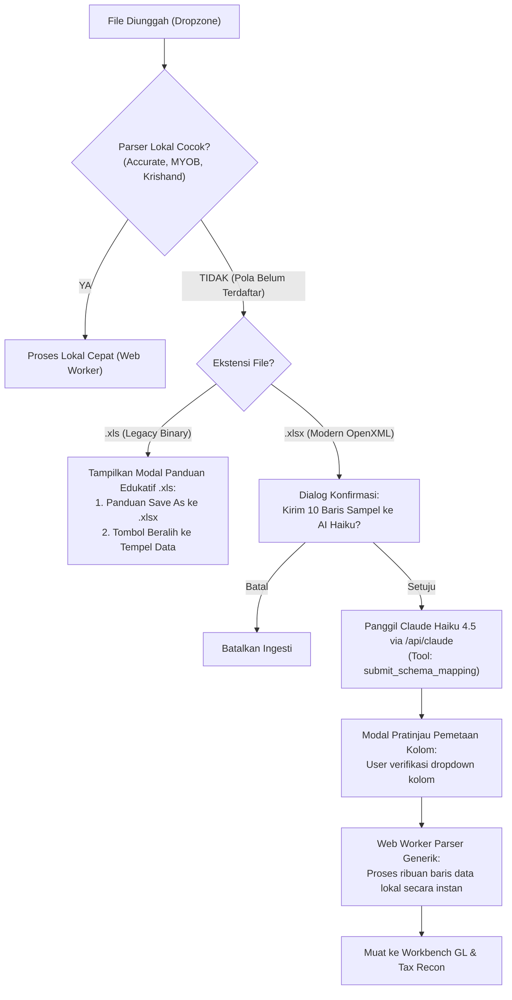

# AI Schema Mapping & Selective .xls Guardrail Specification

## 1. Intent & Purpose
Provide an intelligent hybrid ingestion pipeline for general ledger (GL) files:
1. **Selective .xls Guardrail**: Guard legacy `.xls` files with unrecognized patterns by rejecting them with an educational modal, guiding users to Save As `.xlsx` or use the 3-column Paste Import tool.
2. **Hybrid AI Schema Mapping (.xlsx)**: When an unrecognized `.xlsx` file is uploaded, extract only the first 10-15 rows locally, send them to Claude Haiku 4.5 to infer column mapping, show a verification dialog, and parse the remaining rows locally with 100% native performance.

## 2. Core Architecture & Workflow

## 3. Specifications

### A. Selective `.xls` Guardrail Modal
- **Component**: `src/components/modals/LegacyXlsGuideModal.jsx`
- **Trigger**: When `parserWorker` reports `unrecognized_format` and file extension is `.xls` or file is identified as legacy binary.
- **Content**:
  - Clear explanation: format `.xls` lama rentan distorsi karakter/sel.
  - Action 1: Panduan visual cara membuka file di MS Excel dan `Save As -> Excel Workbook (.xlsx)`.
  - Action 2: Tombol satu klik: *"Beralih ke Tempel dari Excel (3 Kolom)"*.

### B. AI Schema Mapping Tool & Service
- **Service**: `src/services/claudeService.js`
- **Tool Definition**: `SCHEMA_MAPPING_TOOL` (`submit_schema_mapping`)
  - Parameters: `headerRowIndex`, `dataStartRowIndex`, `dateColumnIndex`, `coaColumnIndex`, `accountNameColumnIndex`, `descriptionColumnIndex`, `debitColumnIndex`, `creditColumnIndex`, `balanceColumnIndex`, `voucherNoColumnIndex`, `confidence`, `reasoning`.
- **Model**: `claude-haiku-4-5-20251001` (fast, economical).

### C. Column Mapping Verification Dialog
- **Component**: `src/components/modals/SchemaMappingConfirmModal.jsx`
- **UI**:
  - Sample preview table showing the 10 extracted rows with detected column highlights.
  - Dropdown selectors for each target GL field (Tanggal, COA, Nama Akun, Keterangan, Debit, Kredit, Saldo, No. Bukti).
  - Validation check: ensure at least Tanggal, Keterangan, and Debit/Kredit or Saldo are selected.
  - Action: "Terapkan & Proses Data" $\rightarrow$ sends confirmed mapping back to Web Worker.

### D. Generic Dynamic Parser in Web Worker
- **File**: `src/parsers/parserWorker.js` & `src/parsers/genericExcelParser.js`
- **Logic**: Iterates over all rows in the sheet starting from `dataStartRowIndex` using user-confirmed column indexes.
- **Sanitization**: Formats dates with `normalizeAccurateDate`, cleans currency with `cleanBalance`, discards blank rows.

## 4. Verification & Testing Plan
1. Unit tests for `genericExcelParser.js` with simulated irregular columns.
2. Unit tests for `detectSchemaWithClaude` in `claudeService.test.js`.
3. Component tests for `LegacyXlsGuideModal.test.jsx` and `SchemaMappingConfirmModal.test.jsx`.
4. Playwright E2E test adding coverage for unrecognized `.xlsx` detection and `.xls` guard modal.

